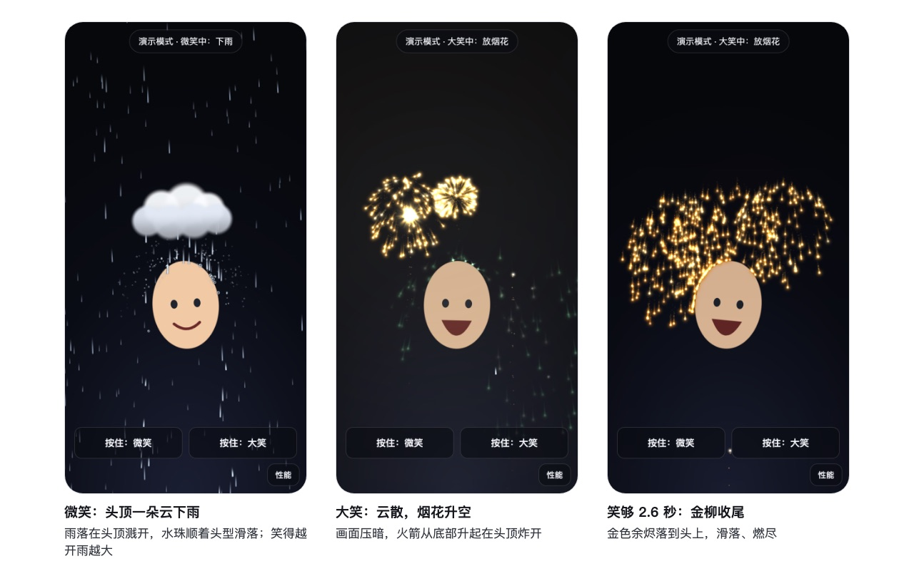

# 笑一笑 AR · Smile Rain, Laugh Fireworks

浏览器里的直播间 AR 互动原型：**微笑时头顶飘来一朵云下雨，笑得越开雨越大；大笑时云被吹散、烟花升空在头顶炸开，火花落到头上会弹开。晃头能甩掉水珠和火花。** 人脸追踪、表情判定、物理和渲染全部在本机完成，画面不上传。

A browser AR prototype for a LIVE room: smile and a little cloud rains on your head; laugh and it blows away as fireworks rise and burst above you, their sparks bouncing off your head. Everything runs on-device.

- **Live demo**：<https://lyra-gongyingli.github.io/ar-smile-fireworks/>（手机或电脑浏览器打开，允许摄像头）
- **没有摄像头**：<https://lyra-gongyingli.github.io/ar-smile-fireworks/?demo=1> 演示模式，可拖动头像，按住按钮或键盘 S / L 模拟微笑、大笑
- **性能面板**：点右下角「性能」，或加 `?hud=1`，会显示帧率、推理耗时、检测频率和头部碰撞体轮廓



## 判定规则

PM 的需求只有一句话，原型先把它翻译成可验收的规则。分数是 MediaPipe 输出的 blendshape，先减去每个人自己的静息基线。

| 状态 | 进入条件 | 退出条件 | 效果 |
| --- | --- | --- | --- |
| 微笑 | 嘴角上扬 ≥ 0.42，累计 120 ms | < 0.28 持续 220 ms | 头顶飘来一朵云下雨。雨打到头顶溅开，部分水珠挂在头上、顺着头型滑落；笑得越开云越大，雨铺满全屏 |
| 大笑 | 嘴角 ≥ 0.35 且张嘴 ≥ 0.30，累计 150 ms（漏桶计时，“哈哈哈”的开合不会打断） | 张嘴 < 0.16 或嘴角 < 0.22 持续 380 ms | 云被吹散、雨停，画面慢慢压暗；3 枚烟花从画面底部升空，在头顶上方炸开，之后每 0.45–0.9 s 再放，笑得越大越密；连续笑 2.6 s 放三朵金柳收尾 |

以下情况**不会**触发：说话（嘴角不够）、打哈欠（只张嘴）、“O”型嘴惊讶（funnel/pucker 一票否决）、单帧抖动、侧脸超过约 40°（分数不可靠，保持当前状态）。规则和这些反例都有单测（`tests/expression.test.js`）。

## 特效设计

微笑和大笑是一条情绪线上的两档：雨是铺垫，烟花是高潮。

| 环节 | 做法 | 为什么 |
| --- | --- | --- |
| 雨从哪来 | 头顶一朵云跟着头走（略带滞后，像飘着），雨落在头上；笑得更开，云变大，雨铺满全屏 | 只在头顶下雨，直播间一眼能看出是谁在笑；用白云和亮雨，避开“头顶乌云”的倒霉联想 |
| 雨落到头上 | 溅起水花和小水环；落在头顶的雨约 12% 留成水珠（同时最多 16 颗），顺着头型爬到两侧再滴落，晃头会被甩掉 | 让“碰到头”看得见 |
| 雨分远近 | 远处的雨更细、更慢、更暗，从头后面穿过（被头挡住）；雨丝和水珠带一圈淡淡的暗边 | 有景深，人站在雨里；真人画面通常很亮，暗边让白色的雨在亮背景上也看得清 |
| 大笑接管 | 云被吹散、雨停，画面慢慢压暗（顶部最多 18%，越往下越轻）；火箭从底部升起，在头顶上方炸开，火花叠加发亮，同时照亮画面 | 高潮时画面只留一个主角；亮背景上的烟花也醒目 |
| 烟花种类 | 牡丹、菊花（长尾）、环形、心形、金柳，随机不连续重复；心形最多 3 秒一次 | 连续笑不重样；心形呼应直播间的“比心” |
| 撞头 | 火花撞到头会弹开，撞击点闪一下星光；落在头上的会在那里燃尽 | 碰撞看得见，又不会沿碰撞体堆成一圈、露出它的椭圆形状 |
| 收尾 | 连续笑 2.6 秒放三朵金柳，金色余烬慢慢落到头上、滑落 | 奖励笑得久的人 |

设计参考（只参考表现形式，没有用它们的代码或素材）：头顶小云，见 [Jeeliz FaceFilter](https://jeeliz.github.io/jeelizFaceFilter/) 的 “Clouds above the head” 示例；水珠挂在头上再滑落，见 [Webcam Snowstorm](https://blog.gskinner.com/archives/2005/08/flash_8_webcam.html)（雪落在头肩上堆积、可以刷掉）；雨和烟花的情绪对照，见 [FaceTime 反应特效](https://support.apple.com/guide/iphone/use-video-conferencing-features-iphaa0b5671d/ios)。

## 架构

```
摄像头 640×480@30 ──► FaceLandmarker (WASM + WebGL, GPU 优先)
                        │  只在“有新帧”时推理；推理占主线程 ≤ 40%；无脸时降到 5 次/秒
                        ├─► 478 个关键点 ──► 头部椭圆碰撞体（cover 裁切 + 镜像映射，One Euro 平滑，速度外推 ≤ 50 ms）
                        └─► 52 个 blendshape ──► 表情状态机（个人基线 / 迟滞 / 漏桶计时 / 侧脸门控）
                                                   │
      特效调度（头顶云和雨 / 火箭和 5 种烟花）◄──────┘
                                  │
          粒子池（定长 TypedArray，交换删除，零分配）──► 椭圆碰撞（反弹 / 滑落 / 燃尽）
                                  │
                 WebGL 点精灵：一次上传、两次 draw call（光点叠加发亮，云朵正常叠放）；
                 大笑时加一次全屏压暗和补光（无 WebGL 时退回 Canvas 2D）
```

| 文件 | 职责 |
| --- | --- |
| `src/tracker.js` | 模型下载（带进度）、GPU→CPU 回退、推理调度 |
| `src/face.js` | 关键点 → 屏幕坐标头部椭圆；One Euro 滤波 |
| `src/expression.js` | blendshape → 无 / 微笑 / 大笑 |
| `src/particles.js` | 粒子池、物理、椭圆碰撞（反弹、滑落、燃尽） |
| `src/effects.js` | 头顶云和雨；火箭、5 种烟花、金柳收尾；画面补光 |
| `src/sprites.js` | 云朵、火箭头这类不归粒子池管的精灵 |
| `src/renderer-gl.js` / `renderer-2d.js` | 渲染（7 种点精灵形状、补光） |
| `src/main.js` | 主循环、模式切换、画质档位自适应 |

## 性能

推理是成本大头，特效不是：金柳收尾时约 3500 个粒子，WebGL 路径每帧 JS 平均 0.4 ms（最高 0.9 ms）；一次人脸推理约 10 ms。所以优化集中在“少推理、推理不卡渲染”。

- **只推理新帧**：用 `requestVideoFrameCallback` 判断摄像头是否出了新帧。120 Hz 屏幕上的 rAF 是摄像头帧率的 4 倍，不判断就会对同一帧重复推理。
- **推理预算**：按实测耗时把推理频率限制在主线程 ≤ 40%，最低 8 次/秒；前 3 帧（编译着色器）不计入。
- **无脸待机**：1.5 s 没检测到人脸，降到 5 次/秒。
- **零分配热路径**：粒子是定长 TypedArray，删除用交换，渲染一次上传、两次 draw call（光点叠加发亮，云朵正常叠放）。云朵和飞行中的火箭也是定长数组；只有大笑时多画一次全屏的压暗和补光。
- **画质档位**：按帧间隔自动升降（粒子上限、像素比），以屏幕自身刷新率为基准，iOS 低电量模式锁 30 Hz 时不会误降档。
- **能力检测在下载之前**：MediaPipe 1.2 只提供 SIMD 版 wasm，CPU 推理也要用 WebGL 转换画面。缺任一项的设备不下载模型，线上只传输 0.1 MB（未压缩 0.29 MB），直接给出原因和演示模式。

实测（除标明真机的一行，都是 Apple Silicon 笔记本上的 Chrome 无头模式 + Metal，假摄像头注入人脸视频）：

| 场景 | 帧率 | 每帧 JS | 单次推理 | 检测频率 |
| --- | --- | --- | --- | --- |
| 桌面 1280×800，有人脸 | 60 | 5.5 ms | 10 ms（GPU） | 28–32 次/秒 |
| 手机尺寸 390×844，CPU 降速 4 倍 | 56–60 | 6–8 ms | 16–18 ms | 约 20 次/秒（预算自动降频） |
| 真机：一台手机，微笑下雨时（性能面板读数） | 59 | 6.3 ms（最高 20 ms） | 17.4 ms（GPU） | 20 次/秒，和降速估计一致 |
| 画面里没有人脸 | 60 | 0.4–1 ms | 7 ms | 4–8 次/秒（待机） |
| 演示模式，金柳收尾约 3500 个粒子 | 60 | 平均 0.4 ms 以内，最高 1 ms（CPU 降速 4 倍 0.7 ms；Canvas 2D 回退 0.9 ms） | — | — |

首次加载原始体积 18.9 MB（wasm 14.6 MB + 模型 3.8 MB + 脚本 0.6 MB），GitHub Pages 会 gzip，实测传输 7.7 MB；10 分钟缓存内再次打开约 0.3 秒就绪。大文件同时向本站和镜像下载（wasm 用 npmmirror，模型用 jsDelivr），先到先用，并逐个核对固定的 SHA-256；国内网络下 wasm 一般从 npmmirror 拿，快好几倍。镜像只提供静态文件，摄像头画面仍然只在本机处理。

## 边缘情况

| 情况 | 处理 |
| --- | --- |
| 拒绝摄像头权限 / 没有摄像头 / 被会议软件占用 | 分别提示原因，可重试或进入演示模式 |
| 非 HTTPS、微信等 App 内置浏览器 | 提示用 HTTPS 链接或系统浏览器打开 |
| 没有 WebGL、没有 Wasm SIMD（如 iOS 16.4 以前） | 下载前拦截，说明原因，保留演示模式 |
| GPU 推理初始化失败或运行中失败 | 自动改用 CPU 重建 |
| 没检测到人脸、侧脸过大 | 顶部提示调整姿势；效果暂停而不是误触发 |
| 有人天生“笑眯眯” | 个人基线自动吸收静息值（上限 0.3，真笑不会被吸收） |
| 竖屏手机裁掉画面两侧 | 关键点按 `object-fit: cover` 同样的裁切映射，碰撞体不偏移 |
| 切到后台 | 停止渲染和推理 |
| 低端机掉帧 | 自动降画质档位 |
| 光敏 | 爆炸核心的闪光约 120 px，任意 1 秒内最多 3 次（WCAG 2.3.1）；烟花照亮画面的亮度变化 < 10%，按 WCAG 的定义不算闪光；大笑时的压暗最多 18%、时间常数 0.5 秒，任何 1/3 秒内的变化都不到 10%（有单测） |
| 脸贴近镜头、头顶没有空间 | 云先缩小（最小为头宽的 55%），再最多沉进头发 0.2 倍头高，不挡额头和眼睛 |
| GPU 限制点精灵尺寸（常见 511 px） | 整朵云按比例缩小，不会被切成碎块 |

## 本地运行与测试

```bash
npm run serve   # http://localhost:5173（localhost 视为安全上下文，可用摄像头）
npm test        # 60 个单测：表情规则、碰撞物理、特效调度、坐标映射、画质调节、多源下载
```

调试参数：`?hud=1` 性能面板（也可点右下角按钮）、`?demo=1` 演示模式、`?tier=0|1|2` 固定画质档、`?cpu=1` 强制 CPU 推理、`?renderer=2d` 强制 Canvas 2D、`?caps=gl` 模拟没有 WebGL。

## 第三方

- [MediaPipe Tasks Vision](https://www.npmjs.com/package/@mediapipe/tasks-vision) 1.2.2 与 [Face Landmarker 模型](https://ai.google.dev/edge/mediapipe/solutions/vision/face_landmarker)，Apache-2.0，见 `vendor/mediapipe/README.md`。
